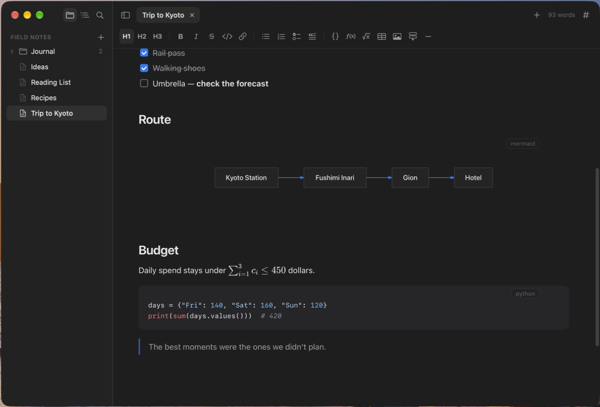

<p align="center">
  
</p>

<h1 align="center">Margin</h1>

<p align="center">
  A lightweight Markdown editor for macOS.<br>
  What you see is the file — folders open as windows, files as tabs.
</p>

<p align="center">
  
  
</p>

## Features

- **Edit the rendered page.** Type `# ` for a heading, `- ` for a list, ` ``` ` for code — or use the format bar.
- **A folder per window, files as tabs**, like VS Code. Quick open with ⌘P, search the whole folder with ⇧⌘F.
- **Saves as you type.** When another program (an AI agent, say) changes the file, it reloads in place and your cursor stays put.
- **Tables, math, code, diagrams**: GitHub-style tables, KaTeX formulas, syntax highlighting, and Mermaid diagrams drawn right in the page.
- **An outline rail** beside the text — hover to preview a section, click to jump.
- **Two editors**, switchable in Settings: *Web* (true what-you-see-is-what-you-get) and *Native* (TextKit 2, about half the memory).
- **Export** to HTML or PDF, and print.
- **Updates itself** — checks once a day, downloads and installs with one click (Settings › General to turn it off).

## Install

### Homebrew (recommended)

```bash
brew tap bluepi0j/tap
brew install --cask margin
```

### Download

1. Download the latest `Margin-x.y.z.zip` from [Releases](https://github.com/bluepi0j/margin/releases).
2. Unzip it and drag **Margin** into Applications.
3. Margin isn't notarized by Apple yet, so the first time you open it macOS says it can't verify the developer. Open **System Settings › Privacy & Security**, scroll down and click **Open Anyway** (or run `xattr -dr com.apple.quarantine /Applications/Margin.app`). After that it opens normally, and updates install without asking again.

Margin needs macOS 14 Sonoma or later, on Apple silicon or Intel.

## Privacy

Margin edits and saves your files on your Mac. It checks GitHub for updates once a day; turn that off in Settings › General. The Web editor also loads remote images referenced by a document, contacting their servers. HTML exports embed available local images and formula fonts; remote image links remain external.

## Build from source

You need macOS 14+ and Xcode (for the Swift toolchain and SDK). Node.js 20+ (22 is used in CI) is needed for web editor development and tests; its built output is in the repo.

```bash
git clone https://github.com/bluepi0j/margin.git
cd margin
scripts/build-app.sh            # builds dist/Margin.app (add --universal for Apple silicon + Intel)
open dist/Margin.app
```

Run the tests:

```bash
(cd WebEditor && npm ci)         # once, for the web editor's tests
scripts/test.sh
```

After changing the web editor in `WebEditor/src`, rebuild its bundle:

```bash
scripts/build-editor.sh
```

### Layout

| Path | What's there |
| --- | --- |
| `Sources/MarginCore/` | Pure logic (open routing, file tree, text commands, table edits…), unit tested |
| `Sources/Margin/` | The app (AppKit + SwiftUI); `Resources/Editor/` is the bundled web editor |
| `WebEditor/` | Source of the web editor (TypeScript + TipTap) |
| `Vendor/` | swift-markdown-engine with a small patch — see `Vendor/README.md` |
| `scripts/` | Build, test, release, and draw the app icon |

### Releasing

Releases are made by the **Release** workflow (Actions › Release › Run workflow), which only the repository owner can run. Give it a version like `1.2.0`; it builds a universal app, signs the update for Sparkle, publishes the GitHub release with `appcast.xml`, and updates the cask in [bluepi0j/homebrew-tap](https://github.com/bluepi0j/homebrew-tap). `scripts/release.sh` does the packaging and can be run locally to try it out.

## License

[MIT](LICENSE). `Vendor/swift-markdown-engine` is Apache 2.0 (see the LICENSE inside it). Updates use [Sparkle](https://sparkle-project.org) (MIT).
